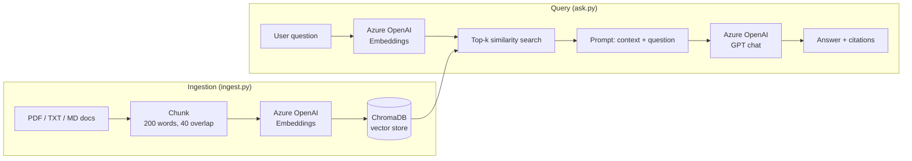
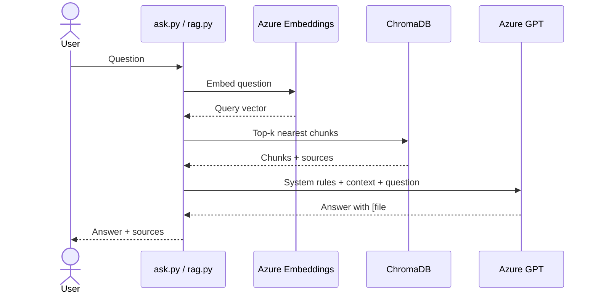

# Telecom-RAG

Question-answering over telecom/satellite documents with citations.
Python · Azure OpenAI (embeddings + chat) · ChromaDB · Docker

## Architecture



## Query Flow



## Setup
1. Create an Azure OpenAI resource; deploy a chat model (e.g. `gpt-4o-mini`) and `text-embedding-3-small`.
2. `cp .env.example .env` and fill in endpoint, key, deployment names.
3. Put public documents (e.g. ITU / 3GPP specs) in `data/`.
4. Run:
```bash
pip install -r requirements.txt
python ingest.py
python ask.py "What is the difference between C-band and Ku-band?"
```
Docker: `docker build -t telecom-rag . && docker run --env-file .env -v $(pwd)/data:/app/data -it telecom-rag python ask.py "your question"`

## Evaluation
Edit `eval.json` with 20 questions + expected keywords, then `python eval.py`.

| Metric | Result |
|---|---|
| Retrieval hit-rate | _fill in_ |
| Answer accuracy | _fill in_ |

## Design notes
- Answers constrained to retrieved context; says "don't know" otherwise (reduces hallucination).
- `upsert` makes re-ingestion idempotent.
- Temperature 0 for reproducible answers.

## Ideas
Hybrid search (BM25 + vector), re-ranking, Azure AI Search as the vector store, FastAPI endpoint.
